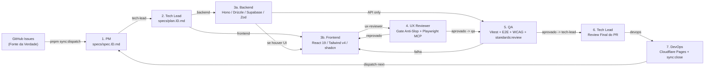

# 🤖 Arquitetura de Agentes Paperclip AI — Dinheirizz

> **Status:** Ativo (Arquitetura de 7 Agentes Isolados + Gate Anti-Slop)  
> **Company ID:** `7cc4de9e-1eb0-44ea-8d5b-43d3d0d91655`  
> **Project ID:** `1a62fd49-1e2a-468e-9edf-24125fdf9f7c`  
> **Repositório:** `leozizz/dinheirizz` (`C:\Code\Leozizz\dinheirizz`)  

---

## 1. Matriz de Agentes Ativos (7 Especialistas)

Todos os agentes executam sob `adapterType: "antigravity_local"`, `model: "gemini-3.8-flash-medium"`, `instructionsBundleMode: "external"`, `wakeOnDemand: true`, `wakeOnAssignment: true`, `wakeOnAutomation: true`, e possuem sua própria pasta isolada em `.agents/<persona>/` contendo cópias de `AGENTS.md`, `STANDARDS.md` e o prompt específico `<persona>.md`.

| Persona | Agent Name | Role / Icon | UUID Real (Paperclip) | Reports To | `instructionsRootPath` |
| :--- | :--- | :--- | :--- | :--- | :--- |
| **Tech Lead** | `Dinheirizz \| Tech Lead` | `engineer` / `crown` | `0e5af8f2-3ff8-4863-93ec-1989b4d2738d` | `null` | `.agents/tech-lead` |
| **PM** | `Dinheirizz \| PM` | `pm` / `target` | `f7accc8b-e406-443c-b9c4-2c1845509723` | `Tech Lead` | `.agents/pm` |
| **Backend** | `Dinheirizz \| Backend` | `engineer` / `database` | `cab7b4a3-bbbb-4783-835e-2a14339db56f` | `Tech Lead` | `.agents/backend` |
| **Frontend** | `Dinheirizz \| Frontend` | `engineer` / `code` | `caf098be-9365-4e19-8a77-7207ec5bcbb9` | `Tech Lead` | `.agents/frontend` |
| **UX Reviewer** | `Dinheirizz \| UX Reviewer` | `designer` / `gem` | `69ca9a91-5c0c-4644-b819-e7c3704eca80` | `Tech Lead` | `.agents/ux-reviewer` |
| **QA** | `Dinheirizz \| QA` | `qa` / `shield` | `2a962652-06f4-4420-83ff-2d2a647d6804` | `Tech Lead` | `.agents/qa` |
| **DevOps** | `Dinheirizz \| DevOps` | `devops` / `rocket` | `2f8fe03a-6b86-43dc-9744-18c4a82cd4b6` | `Tech Lead` | `.agents/devops` |

### Agente Legado Preservado (Pausado)
- **`Dinheirizz | Fullstack`** (`5eb7f7ed-446e-4d40-9af7-59d6936e69f6`): mantido em status **`paused`** para preservar o histórico de issues anteriores. Novas tarefas nunca são atribuídas a ele.

---

## 2. Topologia do Fluxo Autônomo (7 Etapas)

---

## 3. Catálogo de Skills por Especialidade (`.skills/`)

Todas as 49 skills locais em `.skills/` estão importadas na empresa Paperclip (`POST /api/companies/7cc4de9e-1eb0-44ea-8d5b-43d3d0d91655/skills/import`):

- **Tech Lead (`11` skills):** `agent-standards`, `clean-architecture`, `clean-code`, `best-practices`, `code-review`, `refactoring`, `security-audit`, `product-specs`, `zod`, `supabase-postgres-best-practices`, `vercel-react-best-practices`
- **PM (`6` skills):** `product-specs`, `user-stories`, `agent-standards`, `find-skills`, `unslop-copy`, `design-system`
- **Backend (`14` skills):** `agent-standards`, `clean-architecture`, `clean-code`, `best-practices`, `refactoring`, `hono-skill`, `drizzle-orm`, `supabase`, `supabase-postgres-best-practices`, `zod`, `resend`, `cloudflare`, `security-audit`, `vitest-testing`
- **Frontend (`16` skills):** `agent-standards`, `clean-code`, `best-practices`, `vercel-react-best-practices`, `vercel-composition-patterns`, `tanstack-query-best-practices`, `tailwind-v4-shadcn`, `shadcn-ui`, `zod`, `frontend-design`, `ui-styling`, `design-system`, `unslop`, `unslop-copy`, `accessibility`, `vitest-testing`
- **UX Reviewer (`14` skills):** `unslop`, `ui-anti-slop`, `ui-visual-critic`, `ui-visual-qa`, `ui-preflight`, `impeccable`, `unslop-copy`, `ui-ux-pro-max`, `frontend-design`, `design-system`, `web-design-guidelines`, `brand`, `playwright-cli`, `playwright-skill`
- **QA (`12` skills):** `agent-standards`, `vitest-testing`, `playwright-cli`, `playwright-skill`, `accessibility`, `accessibility-auditor`, `core-web-vitals`, `performance`, `web-quality-audit`, `web-design-guidelines`, `ui-visual-qa`, `security-audit`
- **DevOps (`6` skills):** `agent-standards`, `cloudflare`, `github-actions`, `security-audit`, `performance`, `core-web-vitals`

---

## 4. Playwright MCP & Gate Anti-Slop + Dual-Theme

- **Playwright MCP Headless:** configurado globalmente em `C:\Users\leona\.gemini\config\mcp_config.json`, disponível para o **UX Reviewer** (inspeção visual real desktop/mobile, detecção de AI-Slop, validação de contraste e copy) e para o **QA** (E2E funcional, `browser_console_messages`, `browser_network_requests`, acessibilidade).
- **Dual-Theme (Roadmap Ativo):** O Dinheirizz adota **Dark Luxury** (`#0d0e12` + `#7bc816`) como tema principal atual e **Light Clean** como segundo tema oficial (roadmap ativo). Todo código novo no Frontend deve usar exclusivamente tokens semânticos em `src/index.css` sem cores hardcoded ou `!important`.

---

## 5. Governança Automática (`agent-standards`)

Configurado em `agent.config.json` e `tools/agent-standards/`:
- `pnpm standards:sync` — regenera `.agents/STANDARDS.md`, `CLAUDE.md`, `.cursorrules` e `.github/copilot-instructions.md` (copiar `.agents/STANDARDS.md` para as subpastas isoladas caso regras globais mudem);
- `pnpm standards:review` — valida `arrow functions`, ausência de `any`, ausência de `!important`, ausência de `console.log`, bloqueio de `innerHTML` e isolamento Node/Browser em `src/`;
- `pnpm standards:discover` — analisa aderência do repositório às regras configuradas.
