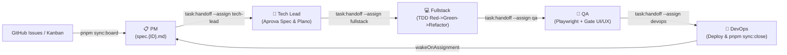

# 🎮 Guia do Operador: Como Disparar e Controlar os Agentes do Dinheirizz

> **Manual de Operação do Time Autônomo Paperclip AI no Dinheirizz**  
> **Empresa:** Leozizz Dev Labs (`7cc4de9e-1eb0-44ea-8d5b-43d3d0d91655`)  
> **Projeto:** Dinheirizz (`1a62fd49-1e2a-468e-9edf-24125fdf9f7c`)  
> **Repositório GitHub:** [`leozizz/dinheirizz`](https://github.com/leozizz/dinheirizz)  

---

## 1. Identificadores Oficiais dos Agentes

| Papel | Nome no Paperclip | Role | Agent ID | Responsabilidade Primária |
| :--- | :--- | :--- | :--- | :--- |
| **👑 Tech Lead** | `Dinheirizz | Tech Lead` | `engineer` | `0e5af8f2-3ff8-4863-93ec-1989b4d2738d` | Governança arquitetural, aprovação de specs, code review e merge. |
| **📋 PM** | `Dinheirizz | PM` | `pm` | `f7accc8b-e406-443c-b9c4-2c1845509723` | Refinamento de demandas, redação de `specs/spec.{ID}.md` e critérios de aceite. |
| **💻 Fullstack** | `Dinheirizz | Fullstack` | `engineer` | `5eb7f7ed-446e-4d40-9af7-59d6936e69f6` | Planos técnicos TDD (`specs/plan.{ID}.md`), implementação e abertura de PR. |
| **🧪 QA** | `Dinheirizz | QA` | `qa` | `2a962652-06f4-4420-83ff-2d2a647d6804` | Testes automatizados, regressão, acessibilidade (WCAG 2.1) e gate UI/UX mobile. |
| **🚀 DevOps** | `Dinheirizz | DevOps` | `devops` | `2f8fe03a-6b86-43dc-9744-18c4a82cd4b6` | CI/CD, build, deploy no Cloudflare Pages e fechamento com dispatch sequencial. |

---

## 2. Comandos Rápidos de Sincronização (Zero Custo de Tokens)

Todos os comandos de sincronização operam via REST API e GitHub CLI local sem consumir cotas de IA:

```bash
# 1. Visualizar status das issues do GitHub vs tarefas do Dinheirizz no Paperclip
pnpm sync:status

# 2. Sincronizar issues abertas do GitHub para o backlog do Paperclip
pnpm sync:board

# 3. Disparar a próxima issue prioritária para o Product Manager
pnpm sync:dispatch

# 4. Fechar uma demanda concluída no GitHub, marcar done no Paperclip e engatar a próxima:
pnpm sync:close <GH_NUMBER> --pr <PR_NUMBER> --dispatch-next
# Exemplo: pnpm sync:close 35 --pr 36 --dispatch-next
```

---

## 3. Pipeline Autônomo Zero-Touch (Active Handoff)

Com `wakeOnAssignment: true` configurado nos 5 agentes, a esteira avança de fase em fase automaticamente:



1. **PM (`Dinheirizz | PM`):** Recebe a demanda, redige `specs/spec.{ID}.md` e transfere para o Tech Lead via `pnpm task:handoff --assign tech-lead`.
2. **Tech Lead (`Dinheirizz | Tech Lead`):** Acorda automaticamente, audita e aprova a spec, autoriza a criação do plano técnico TDD e reatribui para o Fullstack via `pnpm task:handoff --assign fullstack`.
3. **Fullstack (`Dinheirizz | Fullstack`):** Escreve `specs/plan.{ID}.md`, cria a branch `feat/{ID}-{slug}`, implementa sob TDD, garante `pnpm test` e `pnpm build` verdes, abre o PR e reatribui para o QA via `pnpm task:handoff --assign qa`.
4. **QA (`Dinheirizz | QA`):** Executa testes automatizados e o Gate de Qualidade UI/UX (ausência de overflow horizontal, integridade em 375px/390px, z-index e contraste nos temas Dark/Light). Se aprovado, reatribui para o DevOps via `pnpm task:handoff --assign devops`.
5. **DevOps (`Dinheirizz | DevOps`):** Valida build, merge do PR e executa `pnpm sync:close <ID> --pr <PR> --dispatch-next`, finalizando a issue no GitHub e engatando a próxima automaticamente.

---

## 4. Helper de Handoff Manual entre Agentes

Caso precise transferir uma tarefa manualmente pelo terminal durante testes ou alinhamentos:

```bash
# Transferir para o Tech Lead
pnpm task:handoff --assign tech-lead --comment "Ajustes realizados"

# Transferir para o Fullstack
pnpm task:handoff --assign fullstack --comment "Aprovado para início"

# Transferir para o QA
pnpm task:handoff --assign qa --comment "PR pronto para testes"

# Transferir para o DevOps
pnpm task:handoff --assign devops --comment "Testes aprovados"

# Concluir tarefa
pnpm task:handoff --status done --comment "Demanda homologada"
```

---

## 5. Como Destravar Tarefas Canceladas ou Interrompidas (Execution Blocker)

Quando uma execução em andamento é cancelada pelo operador (ex: para reiniciar o computador ou interromper um loop), o Paperclip ativa um mecanismo de segurança chamado **`Execution Blocker`** (`legacy_execution_requires_reconciliation`). 

Enquanto esse bloqueio estiver ativo, o Paperclip propositalmente **ignora** o botão `Run now`, menções no chat e reatribuições, para proteger o repositório contra reexecuções cegas.

### Como destravar via terminal (1 comando):
```bash
pnpm task:unblock
```
*O comando detecta a tarefa com bloqueio, resolve a ação de recuperação atestando a integridade dos arquivos em disco, recoloca a tarefa em `in_progress` e acorda o agente atribuído imediatamente.*

### Como destravar via interface web do Paperclip:
1. Abra a issue no navegador (`http://localhost:3100`).
2. No banner superior **"Recovery needed"**, clique em **Inspect run**.
3. Clique no botão de reconciliação (**Continue** ou **Retry**).
4. Ou, no chat da tarefa, digite o comando `/new` para redefinir o contexto sem travas residuais.
