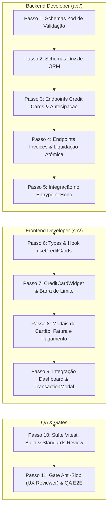

# plan.53.md
# Plano de Implementação — feat(finance): Conciliação Inteligente de Faturas de Cartão de Crédito com Ciclos e Parcelamento

> **Status:** Aprovado pelo Tech Lead (Fase 2 SDD)  
> **Issue GitHub:** #53 / **Paperclip:** LEO-59  
> **Branch Base:** `main` ➔ **Branch de Trabalho:** `feat/53-credit-cards-invoices`  
> **Documento de Referência:** `specs/spec.53.md`  

---

## 1. Resumo do Entendimento

A demanda da Issue #53 / LEO-59 tem como objetivo equipar o Dinheirizz 2.0 com uma gestão avançada e profissional de cartões de crédito e ciclos de faturas, eliminando o descompasso entre consumo imediato de caixa e limites de crédito:

1. **Modelagem Relacional Drizzle ORM:** Criação das tabelas `credit_cards` e `invoices`, com suporte a vínculo relacional direto na tabela `transactions` (`creditCardId` e `invoiceId`).
2. **Ciclo Financeiro & Regra do "Melhor Dia de Compra":** Despesas efetuadas antes do dia de fechamento entram na fatura corrente; despesas a partir do dia de fechamento entram na fatura do ciclo seguinte. Compras parceladas geram registros alocados sequencialmente nas faturas futuras.
3. **Endpoints REST no BFF HonoJS:** Endpoints para listagem de cartões com cálculo dinâmico de limites (`limitAmount`, `usedLimit`, `availableLimit`), cadastro/edição de cartões, liquidação atômica de fatura (`POST /api/v1/invoices/:id/pay`) com débito na conta bancária e antecipação de parcelas futuras (`POST /api/v1/credit-cards/:id/anticipate-installments`).
4. **Interface Visual Anti-Slop & Dual-Theme:** Componentes modernos de cartão virtual (proporção 1.586:1, Glassmorphism, chip metálico SVG), barra de progresso de limite com cores semânticas (verde <60%, âmbar 60-85%, vermelho >85%), modais de liquidação/antecipação e integração com `TransactionModal.tsx`.
5. **Acessibilidade e Qualidade:** Controles com touch target ≥44px, `data-testid` determinísticos em 100% dos elementos e conformidade com WCAG AA e `STANDARDS.md`.

---

## 2. Dúvidas e Ambiguidades

Nenhuma ambiguidade detectada. A especificação `specs/spec.53.md` detalhou formalmente os schemas Zod, contratos de payload/response, status de fatura (`open`, `closed`, `paid`, `overdue`), regras de parcelamento e cálculos matemáticos de limites.

---

## 3. Divisão de Responsabilidades e Sequência de Implementação

> O fluxo obedece rigorosamente a metodologia **TDD (Red ➔ Green ➔ Refactor)**.  
> As etapas estão divididas entre **Backend Developer** (`api/`, `drizzle/`) e **Frontend Developer** (`src/`).



---

### 🔹 FASE A: BACKEND DEVELOPER (`api/`, `drizzle/`)

#### Passo 1 — Schemas Zod Compartilhados de Validação (TDD)
- **🔴 Red:** Criar testes unitários para os schemas Zod em `api/tests/credit-cards-schemas.spec.ts` validando:
  - Rejeição de `closingDay` e `dueDay` fora do intervalo 1-31.
  - Rejeição de `limitAmount` zero ou negativo.
  - Validação de `brand` com enums válidos e default `mastercard`.
  - Validação estrita de `payInvoiceSchema` (conta bancária obrigatória, valor positivo).
  - Validação de `anticipateInstallmentsSchema` (mínimo de 1 ID de transação).
- **🟢 Green:**
  - Criar `api/src/schemas/creditCards.ts` e exportar `createCreditCardSchema`, `updateCreditCardSchema`, `payInvoiceSchema` e `anticipateInstallmentsSchema`.
  - Criar espelho compatível para o frontend em `src/schemas/creditCards.ts`.
- **🔵 Refactor:** Inferir e exportar tipos TypeScript estritos (`z.infer<typeof ...>`).

**Arquivos:**
- CRIAR: `api/src/schemas/creditCards.ts`, `src/schemas/creditCards.ts`, `api/tests/credit-cards-schemas.spec.ts`

---

#### Passo 2 — Evolução do Schema Drizzle ORM (`api/src/db/schema.ts`)
- **O que faz:**
  - Adicionar tabela `creditCards`:
    - `id`, `userId` (FK `users.id`), `accountId` (FK `accounts.id`), `name`, `brand`, `limitAmount`, `closingDay`, `dueDay`, `color`, `lastFourDigits`, `archived`, `createdAt`, `updatedAt`.
    - Índices: `credit_cards_user_id_idx`, `credit_cards_account_id_idx`.
  - Adicionar tabela `invoices`:
    - `id`, `creditCardId` (FK `creditCards.id`), `userId` (FK `users.id`), `period`, `closingDate`, `dueDate`, `amount`, `status`, `paidAmount`, `paidAt`, `paymentAccountId`, `paymentTransactionId`, `createdAt`, `updatedAt`.
    - Constraint de unicidade: `(creditCardId, period)`.
  - Adicionar colunas em `transactions`:
    - `creditCardId` (FK `creditCards.id` com `onDelete: 'set null'`).
    - `invoiceId` (FK `invoices.id` com `onDelete: 'set null'`).
- **Arquivos:**
  - ALTERAR: `api/src/db/schema.ts`

---

#### Passo 3 — Rotas de Cartões de Crédito e Antecipação de Parcelas (TDD)
- **🔴 Red:** Criar `api/tests/credit-cards.spec.ts` cobrindo:
  - `GET /api/v1/credit-cards`: 401 sem token, 200 com lista de cartões, limites calculados (`limitAmount`, `usedLimit`, `availableLimit`) e fatura corrente.
  - `POST /api/v1/credit-cards`: 400 com payload inválido, 201 com criação e inicialização de fatura aberta inicial.
  - `GET /api/v1/credit-cards/:id`: 404 para cartão inexistente ou de outro usuário, 200 com dados e faturas.
  - `PUT /api/v1/credit-cards/:id`: 200 atualizando limites ou dias de fechamento.
  - `POST /api/v1/credit-cards/:id/anticipate-installments`: 400 se transação não pertencer ao cartão; 200 reatribuindo as parcelas para a fatura aberta do mês e recalculando o montante total.
- **🟢 Green:**
  - Criar `api/src/routes/creditCards.ts` com handlers protegidos por `authMiddleware`.
  - Implementar lógica de fallback resiliente em memória para execução limpa em testes sem dependência de banco em nuvem.
- **🔵 Refactor:** Isolar helpers de cálculo de limites e datas de ciclo para reutilização.

**Arquivos:**
- CRIAR: `api/src/routes/creditCards.ts`, `api/tests/credit-cards.spec.ts`

---

#### Passo 4 — Rotas de Gestão e Liquidação de Faturas (TDD)
- **🔴 Red:** Criar `api/tests/invoices.spec.ts` cobrindo:
  - `GET /api/v1/invoices/:id`: 200 com itens detalhados da fatura (transações, categorias, parcelas `current/total`).
  - `POST /api/v1/invoices/:id/close`: 200 alterando status para `closed`.
  - `POST /api/v1/invoices/:id/pay`:
    - Validação de conta bancária de débito inexistente (404).
    - Validação de tentativa de pagamento duplicado em fatura já paga (400).
    - Sucesso: atualiza status da fatura para `paid`, registra `paidAmount` e `paidAt`, cria transação de despesa (`type: 'expense'`) na conta bancária vinculada e deduz saldo da conta.
  - Teste de alocação de ciclo ("Melhor dia de compra"): compra antes do dia de fechamento vai para o ciclo atual; no dia de fechamento ou posterior, vai para o próximo mês.
- **🟢 Green:**
  - Criar `api/src/routes/invoices.ts` com handlers e operações atômicas de pagamento.
- **🔵 Refactor:** Garantir respostas padronizadas e tipadas.

**Arquivos:**
- CRIAR: `api/src/routes/invoices.ts`, `api/tests/invoices.spec.ts`

---

#### Passo 5 — Plug nos Entrypoints do BFF Hono
- **O que faz:**
  - Registrar as novas rotas no app principal:
    - `app.route('/v1/credit-cards', creditCardsRouter)`
    - `app.route('/v1/invoices', invoicesRouter)`
  - Garantir proteção dos middlewares de segurança (`secureHeaders`, CORS, `authMiddleware`).
- **Arquivos:**
  - ALTERAR: `api/index.ts`

---

### 🔹 FASE B: FRONTEND DEVELOPER (`src/`)

#### Passo 6 — Tipagens TypeScript e Hook Reativo TanStack Query
- **O que faz:**
  - Atualizar `src/types/database.types.ts` com os tipos TypeScript `CreditCard`, `Invoice`, `CreditCardBrand`, `InvoiceStatus` e extensões de `Transaction`.
  - Criar `src/hooks/useCreditCards.ts`:
    - `useCreditCards()`: query `['credit-cards']` com cache e revalidação.
    - `useCreditCard(id)`: query `['credit-cards', id]`.
    - `useInvoice(id)`: query `['invoices', id]`.
    - Mutations: `createCreditCard`, `updateCreditCard`, `deleteCreditCard`, `payInvoice`, `anticipateInstallments` com invalidação cirúrgica de `['credit-cards']`, `['invoices']`, `['transactions']` e `['accounts']`.
- **Arquivos:**
  - CRIAR: `src/hooks/useCreditCards.ts`
  - ALTERAR: `src/types/database.types.ts`

---

#### Passo 7 — Componente de Cartão Virtual Moderno e Barra de Limite (TDD)
- **🔴 Red:** Criar `src/tests/CreditCards.spec.tsx` testando:
  - Renderização do cartão virtual com dados (nome, bandeira, últimos 4 dígitos, datas de ciclo).
  - Cálculo e renderização da barra de limite consumido com cores semânticas (verde <60%, âmbar 60-85%, vermelho >85%).
  - Exibição do badge de status da fatura (`Aberta`, `Fechada`, `Paga`).
  - Presença de todos os `data-testid` obrigatórios.
- **🟢 Green:**
  - Criar `src/components/cards/CreditCardWidget.tsx`:
    - Design em proporção 1.586:1, cantos `rounded-2xl`, glassmorphism, chip metálico SVG e suporte Dual-Theme (Dark Luxury / Light Clean).
    - Barra de progresso com `role="progressbar"`.
    - Botões de ação rápida com touch target ≥44px.
- **🔵 Refactor:** Polimento estético Anti-Slop utilizando tokens semânticos OKLCH de `src/index.css`.

**Arquivos:**
- CRIAR: `src/components/cards/CreditCardWidget.tsx`, `src/tests/CreditCards.spec.tsx`

---

#### Passo 8 — Modais de Gestão, Faturas e Liquidação (TDD)
- **🔴 Red:** Criar `src/tests/InvoicePayment.spec.tsx` testando:
  - Abertura do modal de pagamento de fatura com valor pré-carregado.
  - Seleção da conta bancária de débito.
  - Disparo da liquidação e fechamento com sucesso.
- **🟢 Green:**
  - Criar `src/components/modals/CreditCardModal.tsx` (criação e edição de cartões com Zod + `react-hook-form`).
  - Criar `src/components/modals/InvoiceDetailsModal.tsx` (lista discriminada de compras e parcelas da fatura).
  - Criar `src/components/modals/InvoicePaymentModal.tsx` (seleção de conta de débito e confirmação de pagamento).
  - Criar `src/components/modals/AnticipateInstallmentsModal.tsx` (seleção de checkboxes de parcelas futuras e prévia do novo total da fatura aberta).
- **🔵 Refactor:** Transições suaves com `framer-motion` e diálogos Radix UI / shadcn.

**Arquivos:**
- CRIAR: `src/components/modals/CreditCardModal.tsx`, `src/components/modals/InvoiceDetailsModal.tsx`, `src/components/modals/InvoicePaymentModal.tsx`, `src/components/modals/AnticipateInstallmentsModal.tsx`, `src/tests/InvoicePayment.spec.tsx`

---

#### Passo 9 — Integração no Dashboard e TransactionModal
- **O que faz:**
  - Atualizar `src/components/dashboard/Dashboard.tsx` para exibir a seção de Cartões de Crédito com o novo `CreditCardWidget` e atalhos para faturas.
  - Atualizar `src/components/modals/TransactionModal.tsx`:
    - Opção de pagamento "Cartão de Crédito".
    - Ao selecionar o cartão, disponibilizar o seletor de parcelas (1x a 24x) com indicação em tempo real de qual fatura receberá a primeira parcela com base no `closingDay` do cartão selecionado.
- **Arquivos:**
  - ALTERAR: `src/components/dashboard/Dashboard.tsx`, `src/components/modals/TransactionModal.tsx`

---

### 🔹 FASE C: QUALIDADE, GATES & HOMOLOGAÇÃO

#### Passo 10 — Suíte Completa de Testes e Auditoria Mecânica
- **O que faz:**
  - Executar `pnpm test` assegurando 100% de testes unitários e de integração verdes no Vitest.
  - Executar `pnpm build` garantindo zero erros de tipagem estrita no TypeScript (`tsc -b`) e bundle Vite íntegro.
  - Executar `pnpm standards:review` garantindo 0 inconformidades com `STANDARDS.md` e `AGENTS.md`.

---

## 4. Arquivos Criados e Alterados

### Arquivos a Criar
```
api/src/schemas/creditCards.ts
api/src/routes/creditCards.ts
api/src/routes/invoices.ts
api/tests/credit-cards-schemas.spec.ts
api/tests/credit-cards.spec.ts
api/tests/invoices.spec.ts
src/schemas/creditCards.ts
src/hooks/useCreditCards.ts
src/components/cards/CreditCardWidget.tsx
src/components/modals/CreditCardModal.tsx
src/components/modals/InvoiceDetailsModal.tsx
src/components/modals/InvoicePaymentModal.tsx
src/components/modals/AnticipateInstallmentsModal.tsx
src/tests/CreditCards.spec.tsx
src/tests/InvoicePayment.spec.tsx
specs/plan.53.md
```

### Arquivos a Alterar
```
api/src/db/schema.ts
api/index.ts
src/types/database.types.ts
src/components/dashboard/Dashboard.tsx
src/components/modals/TransactionModal.tsx
```

---

## 5. Superfície de Regressão

| Arquivo / Módulo | O que afeta | Risco | Mitigação |
|---|---|---|---|
| `api/src/db/schema.ts` | Novas tabelas e colunas em `transactions` | Baixo | Chaves estrangeiras opcionais com `onDelete: 'set null'` para não quebrar transações avulsas |
| `api/index.ts` | Registro de novos endpoints no BFF | Mínimo | Prefixo `/v1/credit-cards` e `/v1/invoices` isolados |
| `src/components/modals/TransactionModal.tsx` | Fluxo de criação de transações | Médio | Testes existentes de transação mantidos intactos; cartão é modo opcional |
| `src/components/dashboard/Dashboard.tsx` | Shell e layout do dashboard | Médio | Testar responsividade e renderização com zero ou múltiplos cartões |
| `src/hooks/useAccounts.ts` | Saldos bancários após liquidação de fatura | Baixo | Revalidação de query `['accounts']` nas mutações de liquidação |

---

## 6. Critérios de Aceite × Passos de Implementação

| Critério de Aceite (da `spec.53.md`) | Atendido no Passo |
|---|---|
| Schema Drizzle ORM com `credit_cards`, `invoices` e colunas em `transactions` | Passo 2 |
| Schemas Zod de validação com regras de dias 1-31 e valores positivos | Passo 1 |
| Endpoint `GET /api/v1/credit-cards` com limites calculados e fatura aberta | Passo 3 |
| Endpoint `POST /api/v1/credit-cards` com inicialização de ciclo | Passo 3 |
| Endpoint `POST /api/v1/credit-cards/:id/anticipate-installments` | Passo 3 |
| Ciclo de fechamento ("Melhor dia de compra") e parcelamento em faturas futuras | Passos 3 e 4 |
| Endpoint `POST /api/v1/invoices/:id/pay` com débito atômico em conta bancária | Passo 4 |
| Hook reativo `useCreditCards` com TanStack React Query v5 | Passo 6 |
| Componente `CreditCardWidget` com proporção 1.586:1 e barra de progresso | Passo 7 |
| Modais de Gestão, Faturas, Pagamento e Antecipação com Radix UI / shadcn | Passo 8 |
| Integração no Dashboard e TransactionModal | Passo 9 |
| Suporte nativo a Dual-Theme (Dark Luxury + Light Clean) e zero AI-Slop | Passos 7 e 8 |
| Atributos `data-testid` determinísticos em 100% dos elementos interativos | Passos 7 e 8 |
| Suíte Vitest, Build TypeScript e `standards:review` 100% aprovados | Passo 10 |

---

## 7. O que está Fora Deste Plano

- Conexão bancária direta Open Finance (Pluggy / Belvo) — fase posterior.
- Importação automática de arquivos OFX/PDF de faturas (escopo de #33).
- Juros de crédito rotativo ou parcelamento de fatura vencida.
