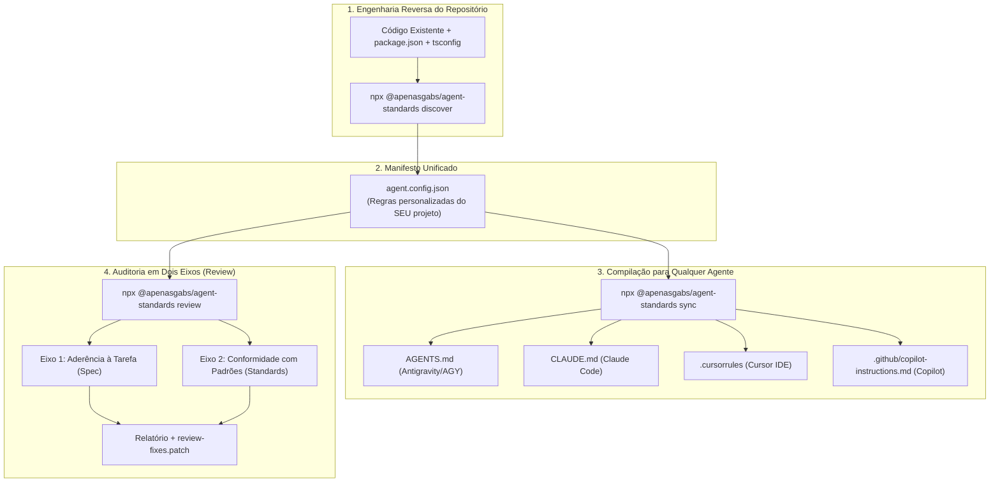

# 🛡️ Universal Agent Standards Engine

> **Discover, generate, and enforce custom coding & architecture standards across Antigravity (AGY), Claude Code, Cursor, GitHub Copilot, and CI/CD pipelines.**

[](https://opensource.org/licenses/MIT)
[](https://nodejs.org/)
[-blue.svg)](https://skills.sh)
[](https://docs.anthropic.com/en/docs/agents-and-tools/claude-code/overview)
[](https://cursor.com)

---

## 🌪️ O Problema: O "Zoológico" de Regras de IA e o Drift de Padrões

Com o avanço dos agentes de codificação, cada ferramenta inventou seu próprio formato de regras:
- Antigravity / AGY usam `AGENTS.md` e skills.
- Claude Code usa `CLAUDE.md`.
- Cursor usa `.cursorrules`.
- GitHub Copilot usa `.github/copilot-instructions.md`.

Isso gera três grandes problemas para times e desenvolvedores:
1. **Drift de Padrões**: Uma melhoria de regras feita em uma ferramenta não é replicada nas outras.
2. **Falta de Customização**: Ferramentas existentes tentam forçar um padrão opinativo e rígido ("todo mundo tem que programar igual"), gerando atrito e rejeição em projetos legados.
3. **Revisões Cegas**: Linters analisam sintaxe, mas não avaliam se o código entregue pela IA **realmente implementou o que foi pedido na issue/tarefa**.

---

## ✨ A Solução: Universal Agent Standards Engine

O **`agent-standards`** atua como uma **Single Source of Truth (SSOT)** customizável e inteligente:



---

## 🚀 Início Rápido (Quickstart)

Sem necessidade de cadastros, assinaturas ou chaves pagas:

### 1. Inicializar no seu Repositório Atual
```bash
npx @apenasgabs/agent-standards init
```
*O motor inspeciona seu repositório, identifica suas dependências e estilo de código, gera o `agent.config.json` e compila todos os arquivos de agentes automaticamente.*

### 2. Apenas Inspecionar o Perfil Técnico
```bash
npx @apenasgabs/agent-standards discover
```

### 3. Sincronizar Regras entre Todas as IAs
```bash
npx @apenasgabs/agent-standards sync
```

### 4. Executar Code Review na Branch Ativa
```bash
npx @apenasgabs/agent-standards review --base origin/main
```

---

## 📦 Presets Nativos Inclusos

O motor vem com presets de referência baseados em arquiteturas consagradas:

| Preset | Stack / Foco | Principais Diretrizes |
|---|---|---|
| **`frontend-react`** | React 19 / Next.js / Vite | Arrow functions obrigatórias, proibição de `any`, `data-testid` em botões/inputs, daisyUI/Tailwind prioritário, bloqueio de XSS. |
| **`scraping-crawler`** | SimpleCrawl / Playwright / Cheerio | Estratégia **HTTP-first, browser-fallback** (Cheerio para SSR, Playwright para CSR), arquitetura modular `BaseScraper` com separação de seletores e mappers. |
| **`minimal`** | Qualquer stack / Universal | Higiene de código, remoção de `console.log` residual, tratamento adequado de `catch` e bloqueio de credenciais hardcoded. |

---

## 🛠️ Customização: O `agent.config.json`

Você tem controle total sobre as regras que seu time deseja aplicar:

```json
{
  "$schema": "https://raw.githubusercontent.com/ApenasGabs/agent-standards/main/schema.json",
  "preset": "frontend-react",
  "rules": {
    "functions": "arrow-only",
    "typescript": {
      "noExplicitAny": true,
      "preferInterfaces": true
    },
    "ui": {
      "preferred": "daisyui",
      "requireDataTestId": true
    },
    "security": {
      "blockInnerHTML": true,
      "blockHardcodedSecrets": true
    },
    "cleanCode": {
      "blockConsoleLog": true,
      "blockEmptyCatch": true
    }
  },
  "docsSync": ["AGENTS.md", "CLAUDE.md", ".github/copilot-instructions.md", ".cursorrules"]
}
```

---

## 🤖 Uso como Skill no Antigravity / skills.sh

Se você utiliza o **Antigravity (AGY)** ou ferramentas compatíveis com o padrão aberto do [skills.sh](https://skills.sh):

```bash
# Adicionar a skill ao seu ambiente
npx skills add ApenasGabs/agent-standards
```

O subagente `spec-code-reviewer` ficará disponível para auditar qualquer repositório no seu ambiente, respeitando rigorosamente o `agent.config.json` local.

---

## 🧱 Automação no CI/CD (GitHub Action Reutilizável)

Adicione a auditoria automática de PRs no seu repositório em `.github/workflows/spec-review.yml`:

```yaml
name: Spec & Standards Review

on: [pull_request]

jobs:
  review:
    runs-on: ubuntu-latest
    steps:
      - uses: actions/checkout@v4
        with:
          fetch-depth: 0
      - uses: actions/setup-node@v4
        with:
          node-version: 20
      - name: Run Code Review
        run: npx @apenasgabs/agent-standards review --base origin/main
```

---

## 📄 Licença

Distribuído sob a licença [MIT](./LICENSE). Desenvolvido por [Gabriel Rodrigues (@ApenasGabs)](https://github.com/ApenasGabs).
